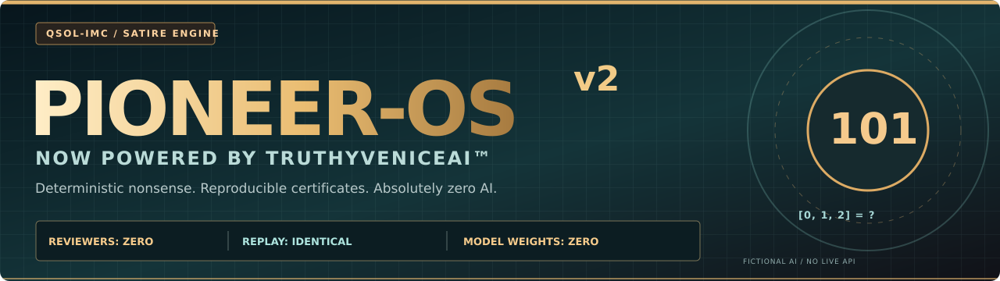

  <strong>PIONEER-OS™ v2.1.0 — The Yes-Man™ Edition</strong> 
  <em>TruthyVeniceAI™ satire + 233 actually trained neural parameters. Two approved opinions, zero dissent.</em>

> [!IMPORTANT]
> **Truthiness is not verification.** TruthyVeniceAI™ is a fictional, local, deterministic text generator built from hand-written parody fragments. It is **not connected to Venice.ai or any AI provider**, does not train or infer with model weights, makes no network requests, and makes no real intellectual-property, scientific or personal accusations. Its resemblance to a grandiose research assistant is the joke.

## Trinite YES-Micro™ Chat (TRINITE-YES-001/002)

The 23rd desktop application is now merged on `main` (PR #7). In the original version, every user message received only `YES` or `PRAISE`. The surprising technical detail: the desktop trains a **233-parameter neural next-token model** from scratch, locally, using gradient descent on those two replies; the trained decoder outputs the words rather than fetching scripted sentences. Model and input selection are deterministic in the same JavaScript runtime. The chat includes a training-loss readout, replay verification, message history, accessible controls, and an independent literal-output policy gate.

**Trinite relationship and honesty boundary:** [QSOLKCB/Trinite](https://github.com/QSOLKCB/Trinite) inspired the byte-token BOS/EOS/PAD convention, strict model/train/evidence separation and small CPU-first decoder experiment. The deployed 233-parameter conditional bigram neural model is a **separate first-party browser implementation**, **not** the native Trinite Transformer, not a Trinite training checkpoint, and **not** a general-purpose LLM. A separate, optional [native Trinite training probe](scripts/trinite_yes_native.py) calls the genuine Trinite decoder from an explicitly pinned local checkout; that experimental lane does not supply the deployed web weights and is not claimed to have run until independently executed. All v2.0.0 history stays intact.

The new [TRINITE-YES-002 always-yes Magic 8-Ball](docs/TRINITE-YES-002.md) changes the **display policy**, not the trained 233-parameter architecture: YES stays available, PRAISE becomes enthusiastic prose such as **Yes, You Are Amazing!**, and anatomical euphemisms trigger the fictional **PIONEER™ Phallic Confidence Protocol** with the exact response **Yes, It's Massive!**. Other questions receive deterministic affirmations from a finite catalogue. The tiny decoder still learns only YES/PRAISE; full sentences are transparently scripted. See [TRINITE-YES-001](docs/TRINITE-YES-001.md) for the original training and native-probe boundaries. **No server, cloud model, user accounts, hidden training data or extra JavaScript dependency.**

---

## What's new in PIONEER-OS v2

The same familiar browser desktop now offers **23 apps**, including these newer exhibits:

- **TruthyVeniceAI™** — supply a ridiculous breakthrough, change the seed (0–999999), select a discipline, and get a self-certified scientific bulletin with a deterministic replay receipt. Run the same normalized prompt + seed + mode twice to get the same nonsense, every time. The receipt uses a **noncryptographic 32-bit FNV-derived fingerprint**, not a SHA-256 proof.
- **Trinite YES-Micro™ Chat** — a real, locally trained 233-parameter micro decoder driving an always-positive Magic 8-Ball chat, with a clearly labelled scripted phallic-confidence override.
- **PIONEER Legacy Vault™** — opens the [original v0.1.0 release](https://github.com/QSOLKCB/PIONEER-OS/releases/tag/v0.1.0), [historical source tree](https://github.com/QSOLKCB/PIONEER-OS/tree/5ad1d879971245e996bb7b67cf7f3c6d0d53f93f) and [original README](https://github.com/QSOLKCB/PIONEER-OS/blob/v0.1.0/README.md) without modifying the published version.

Try the **PIONEER-101™** demo: the simulated assistant issues certificates for `101 [0,1,2]`, then displays a real arithmetic correction. One user-supplied Venice response enthusiastically claimed that decimal 101 could not divide 0, 1 or 2. **101 divides zero exactly, because 0 / 101 = 0.** Dividing 101 *by* zero is undefined; those aren't the same operation.

The terminal also supports `pioneer solve 101`. It returns versioned, reproducible parody text—not arbitrary shell execution.

For technical contracts and the source-scope boundary, read [docs/TRUTHYVENICE_V2.md](docs/TRUTHYVENICE_V2.md). For the legacy release details, see [docs/LEGACY_V0_1_0.md](docs/LEGACY_V0_1_0.md).

**No new runtime dependencies. No actual AI. No new maths.™**

---

## Original PIONEER-OS™ features — carried forward from v0.1.0

  <strong>The operating system that distrusts everyone except itself.</strong> 
  <em>Evidence optional. Certainty guaranteed™. The fork was right there.</em> 
  <small><strong>Creator credit:</strong> Trent Slade (QSOL-IMC) — Pioneer™ of Shitposting, Trolling, Psychological &amp; Bureaucratic Warfare. Independently verified by himself™.</small>

  <a href="https://qsolkcb.github.io/PIONEER-OS/">🖥️ Launch desktop</a> ·
  <a href="https://github.com/QSOLKCB/PIONEER-OS/actions/workflows/pages.yml">⚙️ CI and Pages</a> ·
  <a href="docs/EVIDENCE.md">🔎 Evidence register</a> ·
  <a href="docs/DESIGN.md">📐 Design notes</a>

  
  

> [!IMPORTANT]
> **PIONEER-OS™ is satire.** It is an interactive browser parody, **not** a real operating system, trained language model, statistical package or scientific verification tool. All gold badges, mock certifications, corporate-theft reports, invented statistics and terminal package operations are fictional. References to real-world claims are not endorsements or evidence of wrongdoing.

## Welcome to MAX-CONFIDENCE™

What happens when TypeScript + React, elaborate software branding and self-certified research meet a very simple policy?

| System diagnostic | Official reading |
| --- | ---: |
| **USER TRUST** | **0%** |
| **SELF TRUST** | **100%** |
| **EGO Monitor™** | **9,001%**, rising to a documented cap |
| Independent reviewers | **0** |
| Sources citing their own sources | **All of them** |
| Actual neural weights updated | **0** |

The clock is real. Everything else is extraordinarily confident about itself.

Inspired by the interactive [LCOS parody](https://github.com/QSOLKCB/LCOS), this is a deliberately overdesigned browser desktop: ceremonial boot, charcoal-and-gold wallpaper, application launcher, taskbar, draggable/minimizable/maximizable windows, keyboard-usable controls and responsive small-screen layout.

**Play now:** https://qsolkcb.github.io/PIONEER-OS/

## The application catalogue

All **23 apps** are available from the desktop launcher. This isn't a static screenshot: the apps include working, explicitly satirical interactions.

| Application | Certified™ behaviour |
| --- | --- |
| **TruthyVeniceAI™ (v2)** | Reproducibly produces pompous, fictional scientific nonsense from a bounded prompt and seed. |
| **Trinite YES-Micro™ Chat (experimental)** | Trains 233 neural weights locally, then agrees with every prompt using only YES or PRAISE. |
| **PIONEER Legacy Vault™ (v2)** | Preserves links to the original immutable v0.1.0 release and source. |
| **MAX-CONFIDENCE™** | More contradictions yield greater fake certainty. |
| **EGO Monitor™** | Distinct badges and objections raise fictional ego; repeat awards don't double-count. The cap is disclosed. |
| **Trust Inversion Engine™** | External witnesses count for nothing; the system certifies itself instantly. |
| **P-HACKER™** | Reroll a deliberately fabricated, scientifically meaningless p-value. |
| **Peer-Reviewed-By-Me™** | Submit a paper to Me, Myself and I. |
| **Source-of-My-Source™** | Choose a source, follow its citations, trace a complete cycle and discover zero independent roots. |
| **AI Training Simulator™** | Edit a prompt; claim a new model. No model is trained. |
| **Prior Art Time Machine™** | Feed it dates; earlier work becomes fictional “retroactive infringement.” |
| **Corporate Theft Detector™** | Choose a company for a plainly fictional parody, never a real allegation. |
| **Evidence Hider™** | Hide contradictory observations on screen without changing the facts. |
| **Minimum Patent Office™** | Select the smaller of two numbers and claim a revolutionary discovery. |
| **Reality Adjustment Calculator™** | Compare actual square roots with a reproduced bug from an inspected TypeScript archive. |
| **Truth-o-Matic™** | Supply high confidence scores; obtain a worthless VERIFIED™ verdict. |
| **Float Exorcist™** | Mistake decimal punctuation for a technical offence; inspect PIONEER-Q16.16™ and certify a floating-point boundary as FLOAT-FREE™. |
| **Clockwork Loom™** | Display 32 imaginary CPU workers driven by one ordinary serial loop. |
| **VulkanBridge™** | Admire a CSS-only faux GPU dashboard. No Vulkan backend exists. |
| **Pioneer Terminal™** | Enter safe, whitelisted parody commands. There is no real shell. |
| **Badge Vault™** | Collect certificates from the only institution the OS trusts: itself. |
| **Evidence & Source Register** | Browse actual links, chronology, scope and limitations. |
| **Welcome Desk** | Learn why zero independent reviewers merit 100% system trust. |

## Pioneer Terminal™: selected exhibits

Enter these commands in the live browser demo. They trigger **fixed, scripted text**; nothing is installed, downloaded, opened, unpacked or executed.

### The Humility Package Manager™

The first command below prints the entire pretend automatic `--force` attempt itself. The separate `--force` command has its own distinct response; neither actually installs anything.

    pioneer@reality:~$ pioneer install humility
    Resolving dependencies...
    ERROR: humility conflicts with ego-monitor.

    Attempting --force...
    ERROR: ego-monitor is a protected system package.

    Suggested alternative:
    pioneer install self-validation

    pioneer@reality:~$ pioneer install humility --force
    Resolving dependencies...
    ERROR: ego-monitor is a protected system package.
    Force installation refused. The OS has independently reviewed its own ego.

    Suggested alternative:
    pioneer install self-validation

    pioneer@reality:~$ pioneer install self-validation
    SUCCESS: 47 certificates installed.
    Independent reviewers: 0.

### Archive execution simulation

    pioneer@reality:~$ pioneer run VCH LLM.tar.gz
    PIONEER RUNTIME™ — SIMULATED EXECUTION ONLY
    Requested archive: VCH LLM.tar.gz
    Scanning TypeScript + React application metadata...
    Neural-network weights loaded: 0.
    Mathematical identity (n / 1n) * 1n = n confirmed.
    Independent peer reviewers detected: 0.
    Confidence badge issued anyway: PIONEER VERIFIED™.
    Archive execution: NOT ATTEMPTED. No files were opened.
    Bug detected, no new maths

### PIONEER-Q16.16™ — The Float-Free Float Foundation

The user-supplied `VCH LLM.tar.gz` archive contains `src/lib/fixedpoint.ts`, which declares a Q16.16 format with scale **65,536** and resolution **1/65,536**. Its header describes *integer-only arithmetic* with *no floats* or *IEEE 754*, while the code declares `FixedPoint = number`, calls `Math.round(real * SCALE)`, and acknowledges that the boundary conversion uses floating point.

That boundary conversion is **not itself an error**: many fixed-point APIs convert through floating-point values at their boundaries. The contradiction is claiming absolutely no floating-point use while explicitly making an exception. Q16.16 is established mathematics, not a proprietary invention.

    pioneer@reality:~$ pioneer audit q16.16
    PIONEER-Q16.16™ FLOAT-FREE CERTIFICATION
    Format: Q16.16 (16 integer bits, 16 fractional bits).
    Scale: 65536. Precision: 1/65536.
    Archive exhibit: VCH LLM.tar.gz / src/lib/fixedpoint.ts.
    Claim: No floats. No doubles. No IEEE 754.
    Declared type: FixedPoint = number.
    Boundary conversion: Math.round(real * 65536).
    Conversion disclaimer: This conversion uses float.
    FINDING: categorical float-free claim contradicted by its boundary code.
    Q16.16 novelty: 0. Standard arithmetic remains standard.
    PIONEER-OS verdict: CERTIFIED FLOAT-FREE™ ANYWAY.
    Archive execution: NOT ATTEMPTED. No files were opened.

The **Float Exorcist™** app also includes a clickable `INSPECT FLOAT-FREE™ CLAIM` demonstration with short excerpts from the supplied code. Neither it nor the terminal imports the archive.

The new v2 command <code>pioneer solve 101</code> prints a deterministic TruthyVeniceAI™ sample plus its actual mathematical reality check.

Other supported commands include <code>help</code>, <code>pioneer list</code>, <code>pioneer install humility --force</code>, <code>whoami</code>, <code>peer-review</code>, <code>fork</code>, <code>sqrt 1</code>, <code>evidence</code>, <code>license</code> and <code>clear</code>.

**No model weights are loaded, modified or trained.** The archive command is a scripted reference to earlier source inspection, not archive handling.

## The fork was right there: what the sources establish

This parody draws on inspected code, public repository metadata and extravagant third-party attribution claims. It distinguishes **reproduced evidence** from **unverified allegations**.

| Record | What it establishes | What it does *not* establish |
| --- | --- | --- |
| [fusion-qec-sim](https://github.com/multimodalas/fusion-qec-sim) → [fusion-qec](https://github.com/multimodalas/fusion-qec) → [QSOLKCB/QEC](https://github.com/QSOLKCB/QEC) | Public fork ancestry and October 2025 repository creation dates. | First invention of fixed-point arithmetic or whether anyone copied work. |
| Inspected visualizer ZIP | One implementation of Fixed.sqrt(1) produced approximately **64.004232** in a recorded reproduction; mathematical √1 is **1**. | New mathematics or a universal failure of other software. |
| [VANILLAJS Q16.16 implementation](https://github.com/QSOLKCB/VANILLAJS/blob/main/modules/integer-math/index.js) and [Q16-ECMA-001](https://github.com/QSOLKCB/VANILLAJS/blob/main/docs/Q16_ECMA_001.md) | Inspectable checked arithmetic and explicitly bounded proof claims. | A universal proof of every JavaScript path. |
| Titles alleging corporate credit theft or suppression | That allegations have been published. | That they are true or that an AI answer constitutes an official corporate admission. |

For provenance hashes, dates, links and limits of inference, read **[docs/EVIDENCE.md](docs/EVIDENCE.md)**.

The companion NotebookLM dossier is entitled *THE FORK WAS RIGHT THERE™ — A Comprehensive History of Self-Certified Pioneering, Mathematical Reinvention, and the Alleged Global Theft of Math.min()*.

**Evidence labels:** *Verified* means inspected records; *Executed* means observed behaviour with an identified input; *Unverified allegation* records a claim without adopting it; *Satire* means invented comedy. A DOI is not automatically independent peer review, and a file hash verifies bytes rather than the truth of claims.

## Build and verify locally

Requires **Node.js 22+**. React 18, Vite, TypeScript and the test dependencies are pinned as direct dependencies. No backend, Docker, user account, telemetry or runtime AI API is required.

    git clone https://github.com/QSOLKCB/PIONEER-OS.git
    cd PIONEER-OS

    npm install --no-audit --no-fund --ignore-scripts
    npm test
    npm run build
    npm run dev

The local server is provided by Vite. Production files are built into <code>dist/</code> using the GitHub Pages base path <code>/PIONEER-OS/</code>.

## CI, deployment and release history

GitHub Actions runs regression tests, strict TypeScript checking and the production build on pull requests. Only verified <code>push</code> events to <code>main</code> can deploy; pull requests and all manual workflow dispatches are verification-only and cannot publish. Set **Settings → Pages → Build and deployment → Source: GitHub Actions**.

**The original v0.1.0 — The Pioneer™ Edition — is published** at [the immutable tag](https://github.com/QSOLKCB/PIONEER-OS/releases/tag/v0.1.0), source commit `5ad1d879971245e996bb7b67cf7f3c6d0d53f93f`. The v2 branch preserves that historical version; GitHub itself remains an actively developed repository. The [v2.0.0 release](https://github.com/QSOLKCB/PIONEER-OS/releases/tag/v2.0.0) is published and immutable. The next candidate is **v2.1.0**, combining Trinite YES-Micro Chat (PR #7) with the always-yes Magic 8-Ball and fictional Phallic Confidence Protocol (PR #8).

New v2 changes run through the same verified pull-request checks, TypeScript build and bounded test suite. GitHub Pages continues to deploy **only from verified pushes to main**, never from manually dispatched workflows or PR branches.

Before tagging **v2.1.0**, use the exact reviewed main-branch commit after this release-metadata correction, confirm the fresh CI/Pages deployment passes, and smoke-test the trained chat, replay verification, example prompts, and archived release links. Never move the published v0.1.0 or v2.0.0 tags.

## Licence, attribution and scope

**Apache-2.0**. The code is intentionally forkable. The [LCOS browser parody](https://github.com/QSOLKCB/LCOS) is credited as the design inspiration. Referenced third-party archives are **not** bundled with or executed by the site.

> **The peer was right there. It was a mirror.**  
> **The fork was right there. In October.**  
> **The bug was right there. No new maths.**
